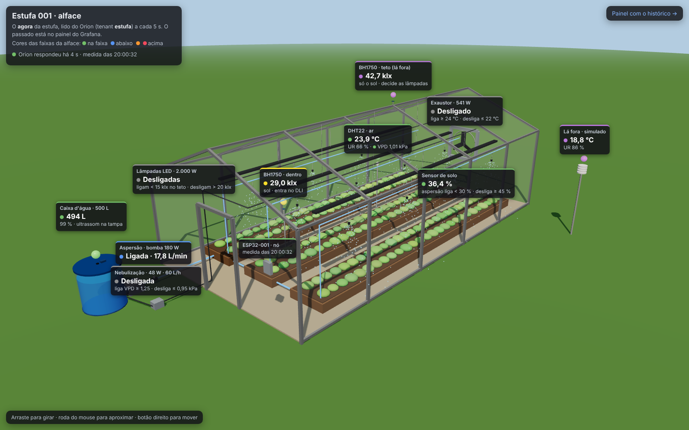

# Painel da estufa — marco da Aula 8 (25/11)

O marco pede três itens:
1. três perguntas que o painel responde, e para quem;
2. a visualização escolhida para cada uma;
3. a consulta SQL de cada painel.

**Critério de pronto:** o painel mostra dados **do próprio grupo**, gravados pelo Cygnus a partir de uma subscrição **que o grupo criou**.

**Cultura:** alface. As faixas do painel e os limites do controle são os da alface ([as decisões e de onde vem cada número](#as-decisões-da-cultura-e-de-onde-vem-cada-número)).

| Peça | Onde |
|---|---|
| Nó da estufa (ESP32 simulada) | `esp32_estufa/`, no tenant `estufa`: publica `t`, `h`, `v`, `m`, `l`, `e`, `a`, `q`, `f`, `p`, `i`, `n` e responde aos comandos |
| Clima externo | `gravador_clima/`: a cada 15 min, copia o `clima-externo` da Base para a `WeatherObserved:FEI` |
| Subscrições do grupo | criadas por `configurar.py`: **"Historico da estufa para o Cygnus"** e **"Clima externo para o Cygnus"** |
| Histórico | MySQL, banco `estufa`: tabelas `` `urn_ngsi-ld_Device_ESP32-001_Device` `` e `` `urn_ngsi-ld_WeatherObserved_FEI_WeatherObserved` `` |
| Painel | `grafana/paineis/painel_estufa.json`, servido em `http://localhost:3002` pelo serviço `grafana-estufa` |
| Estufa em 3D | `estufa_3d/`, servida em `http://localhost:3003` pelo serviço `estufa-3d` |
| Serviços novos | `fiware/docker-compose.override.yml`; o `docker-compose.yml` da Base fica intacto |


## A estufa em 3D: o "agora", como um gêmeo digital

O painel do Grafana mostra o **passado** (MySQL). A página `http://localhost:3003` mostra o **presente**, lido do Orion a cada 5 s, numa estufa em 3D (Three.js) que gira com o mouse.



- **Sensores no lugar:** DHT22, sensor de solo, um BH1750 dentro e outro no teto, ultrassom na tampa da caixa d'água e medidor de vazão no cano da bomba, cada um com um ponto colorido pelas faixas da alface (as mesmas cores do painel).
- **Limites lidos do Orion:** as cores usam os limites da `AgriGreenhouse` (`fanOnTemperature`, `irrigationOnSoilMoisture`…). Se o grupo mudar um limite no Orion, a cena muda junto.
- **Atuadores:**
  - o exaustor gira quando `fanState = ON`;
  - os 12 aspersores no alto jogam água nos canteiros quando `pumpState = ON`; a cor da terra segue o `soilMoisture`; o rótulo da bomba mostra a vazão medida e avisa se a bomba está ligada com menos da metade da vazão de catálogo;
  - as lâmpadas LED acendem quando `lampState = ON` e iluminam os canteiros;
  - a névoa sai dos 10 bicos no alto e evapora quando `mistState = ON`.
- **Caixa d'água:** a água sobe e desce com o `tankWaterVolume`, e a cor segue a reserva: vermelho abaixo de 20 %, laranja abaixo de 40 %.
- **Dia e noite:** a luz da cena segue o BH1750 do teto (`outdoorIlluminance`), que só vê o sol.
- **Rótulos:** quando dois se encostam na tela, o de cima sobe, em qualquer ângulo da câmera.
- **Lá fora:** a estação do lado de fora mostra a `WeatherObserved` gravada pelo `gravador-clima`.

**Como funciona:** o serviço `estufa-3d` (`estufa_3d/servidor.py`, só biblioteca padrão) serve a página e responde `GET /api/estado` com as três entidades do tenant `estufa` em `keyValues`. O navegador nunca fala com o Orion, então não é preciso abrir CORS nem expor a porta 1026. O three.js fica no repositório (`estufa_3d/web/vendor/`), sem depender de CDN.

**No Codespace:** aba **Portas** → **Adicionar Porta** → `3003`, se ela não estiver na lista. O `subir.sh` mostra o link no fim.

## Como subir (Codespace ou máquina com Docker)

**Jeito mais fácil**, da raiz do repositório:

```bash
git pull && bash estufa/subir.sh
```

O script faz os passos abaixo na ordem, para no primeiro erro e, no fim, mostra os contêineres, a última medida e o link do painel. Pode rodar sempre: com a pilha no ar, parada, ou depois que o Codespace desligou. Também serve para atualizar quem tinha a versão anterior.

**Passo a passo** (o que o script faz):

```bash
git pull
cd fiware
docker compose stop esp32-estufa gravador-clima   # só voltam depois do cadastro
docker compose up -d --wait orion
docker compose up -d --wait iot-agent
docker compose up -d --wait cygnus            # inclui o MySQL
python3 ../estufa/configurar.py               # estufa, provisionamento e subscrições (pode repetir)
docker compose up -d --build esp32-estufa     # só DEPOIS do configurar.py
docker compose up -d --build gravador-clima   # sobe junto o clima-externo da Base
docker compose up -d grafana-estufa           # o painel, na porta 3002
docker compose restart grafana-estufa         # carrega o painel do arquivo
```

**Para atualizar quem já tinha a versão anterior** (LDR, limites 24/28 °C): `git pull && bash estufa/subir.sh`. O script para a ESP32 antes do cadastro, porque o `configurar.py` percebe que o `dispositivo.json` mudou e reprovisiona a placa. O histórico fica.

- **No Codespace:** aba **Portas** → porta **3002** → ícone do globo. O painel abre direto, sem login. Para editar, entre com `admin`/`admin`. Se a 3002 não estiver na lista (o link dá *HTTP ERROR 404*), clique em **Encaminhar uma Porta**, digite `3002` e aperte Enter.
- **O Codespace para sozinho após 30 min sem uso**, e a pilha para junto. Para a apresentação, aumente o tempo em GitHub → *Settings* → *Codespaces* → *Default idle timeout* (até 240 min). A mudança vale na próxima vez que o Codespace iniciar.
- **Depois que o Codespace para, rode de novo `bash estufa/subir.sh`.** O desligamento é brusco. Sem correção, o Orion não voltaria (`container fiware-orion exited (1)`, com `PID-file ... found` no log), porque sobra um arquivo de PID de antes. O `docker-compose.override.yml` põe o `/tmp` do Orion em memória, e o arquivo some a cada partida.
- **Para apresentar, suba a pilha uns 30 min antes:** o painel mostra os últimos 30 min, e o DLI só se estabiliza depois do primeiro "dia" simulado completo (10 min). Antes disso, ele projeta o que já passou e pode aparecer laranja.
- **Espere alguns minutos:** as curvas começam vazias e o histórico cresce uma medida a cada 5 s. A física da simulação é acelerada:
  - um "dia" dura 10 min, com 5 min de sol e 5 de noite;
  - o ventilador cicla de dia e fica desligado à noite;
  - um ciclo da bomba leva cerca de 7 min.
- **O clima entra a cada 15 min.** Sem internet, o `clima-externo` responde valores simulados, com `source = simulado`.
- **Para conferir as subscrições:** `curl -s -H 'fiware-service: estufa' -H 'fiware-servicepath: /' localhost:1026/v2/subscriptions`. O esperado é `status: active`, `timesSent` subindo e `lastSuccessCode: 200`.
- **A tabela `estufa_error_log`** pode ter uma linha "doesn't exist" de cada tabela nova. É normal: o Cygnus tenta gravar, cria a tabela e grava de novo, sem perder a leitura.
- **Para mandar um comando à mão:**

  ```bash
  curl -s -X PATCH 'localhost:1026/v2/entities/urn:ngsi-ld:Device:ESP32-001/attrs?type=Device' \
    -H 'fiware-service: estufa' -H 'fiware-servicepath: /' -H 'Content-Type: application/json' \
    -d '{"pumpOn": {"type": "command", "value": ""}}'
  ```

- **Para parar sem perder o histórico:** `docker compose stop`. Nunca use `down -v`.

## As três perguntas

| # | Pergunta | Para quem | Que decisão apoia | Visualização |
|---|---|---|---|---|
| 1 | **A estufa está bem agora?** | o operador da estufa | intervir já (ex.: 25 °C com o ventilador desligado, solo abaixo de 30 % sem a aspersão, VPD acima de 1,5 kPa, caixa abaixo de 20 %) | **Gauge** nas faixas (temperatura, solo, VPD, DLI e caixa d'água) + **Stat** dos quatro relés + **Stat** com a curva do período (umidade do ar, luz dentro, luz no teto e vazão) |
| 2 | **O controle mantém a estufa nas faixas?** | o grupo, que projeta e ajusta a regra (e, na Aula 9, o gêmeo digital) | manter ou mudar os limites 22/24 °C, 30/45 %, 15/20 klx e 0,95/1,25 kPa; ver se a histerese oscila rápido demais; separar "regra ruim" de "dia quente" com a temperatura de fora | **Time series** com as linhas dos limites (temperatura, solo, luz e VPD) e a temperatura externa + **State timeline** dos quatro relés |
| 3 | **Quanto tempo os atuadores ficam ligados?** | quem paga a energia (os quatro relés) e a água (aspersão e névoa) | prever o consumo; avaliar se mudar um limite compensa | **Bar chart** do tempo ligado por janela de 5 min + **Bar gauge** do período (%) + **Stat** (acionamentos, Wh e litros) + **Time series** da caixa e da vazão |

Seguimos a regra da Aula 7: a pergunta escolhe a visualização.
- O valor de **agora** vai num Gauge, quando há uma faixa a respeitar, ou num Stat.
- A **evolução**, num Time series.
- O **estado** de cada relé, num State timeline.
- O **resumo por período**, num Bar chart.

As cores da Pergunta 1:

| Painel | Azul | Verde | Laranja | Vermelho |
|---|---|---|---|---|
| Temperatura | abaixo de 18 °C | 18 a 24 °C | — | a partir de 24 °C (o ventilador deve estar ligado) |
| Umidade do solo | a partir de 45 % (a aspersão deve desligar) | 30 a 45 % | — | abaixo de 30 % (a aspersão deve ligar) |
| VPD | abaixo de 0,45 kPa (ar úmido demais) | 0,45 a 1,25 kPa | 1,25 a 1,5 kPa (a névoa deve estar ligada) | acima de 1,5 kPa (estresse) |
| DLI (24 h) | — | 14 a 18 mol/m²/dia | fora da faixa | — |
| Caixa d'água (500 L) | — | a partir de 40 % (200 L) | 20 a 40 % | abaixo de 20 % (100 L) |

Umidade do ar, luz e vazão ficam sem faixa, só com a curva do período. Quem julga o ar é o VPD, e quem julga a luz é o DLI. Vazão zero é normal com a bomba desligada; o problema é a bomba ligada com vazão baixa (consulta no Orion mais abaixo).

As cores das curvas são fixas em todo o painel: laranja para a temperatura, roxo para o que vem de fora (o clima e a luz no teto), azul-claro para a umidade e a água, amarelo para a luz dentro. Os relés: verde para o ventilador, azul para a aspersão, amarelo-ouro para as lâmpadas e verde-água para a névoa.

### A consulta de cada painel

Todas leem as tabelas do Cygnus. Nelas, `attrValue` é **texto** e `recvTimeTs` está em **milissegundos**, por isso as consultas usam `CAST` e `/ 1000`. As consultas ficam em `grafana/gerar_painel.py`, que gera o JSON do painel. Os limites, as potências e a capacidade da caixa saem do `modelo-dados/`; se eles mudarem, rode o gerador de novo.

**Pergunta 1 — Gauge** (temperatura; o mesmo para `soilMoisture`, `vaporPressureDeficit` e `tankWaterVolume`)

```sql
SELECT
  recvTimeTs / 1000 AS "time",
  CAST(attrValue AS DECIMAL(10,2)) AS "temperatura"
FROM `urn_ngsi-ld_Device_ESP32-001_Device`
WHERE attrName = 'temperature'
ORDER BY recvTimeTs DESC
LIMIT 1
```

**Pergunta 1 — Stat com curva** (umidade do ar, luz dentro, luz no teto e vazão): a mesma consulta da Pergunta 2, com `relativeHumidity`, `illuminance`, `outdoorIlluminance` ou `waterFlow`; o Stat mostra o último valor e a curva ao fundo. A umidade usa `CAST(attrValue AS DECIMAL(6,2))`, porque vai de 0 a 1. A luz usa `CAST(attrValue AS DECIMAL(10,1)) / 1000`, para mostrar em klx.

**Pergunta 1 — Gauge do DLI** (formato *Table*; o painel tem janela própria de 24 h, independente do seletor)

```sql
SELECT
  AVG(CAST(attrValue AS DECIMAL(10,1))) * 0.0185 * 86400 / 1000000 AS "DLI"
FROM `urn_ngsi-ld_Device_ESP32-001_Device`
WHERE attrName = 'illuminance'
  AND $__unixEpochFilter(recvTimeTs / 1000)
```

**Pergunta 1 — Relés agora** (formato *Table*, sem CAST; uma subconsulta por relé; mapeamento `ON` → Ligado, `OFF` → Desligado)

```sql
SELECT
  (SELECT attrValue FROM `urn_ngsi-ld_Device_ESP32-001_Device` WHERE attrName = 'fanState'  ORDER BY recvTimeTs DESC LIMIT 1) AS "ventilador",
  (SELECT attrValue FROM `urn_ngsi-ld_Device_ESP32-001_Device` WHERE attrName = 'pumpState' ORDER BY recvTimeTs DESC LIMIT 1) AS "bomba",
  (SELECT attrValue FROM `urn_ngsi-ld_Device_ESP32-001_Device` WHERE attrName = 'lampState' ORDER BY recvTimeTs DESC LIMIT 1) AS "lâmpadas",
  (SELECT attrValue FROM `urn_ngsi-ld_Device_ESP32-001_Device` WHERE attrName = 'mistState' ORDER BY recvTimeTs DESC LIMIT 1) AS "nebulização"
```

**Pergunta 2 — Time series, dentro** (`temperature`; o mesmo para `soilMoisture`, `vaporPressureDeficit`, `illuminance` e `outdoorIlluminance`)

```sql
SELECT
  recvTimeTs / 1000 AS "time",
  CAST(attrValue AS DECIMAL(6,1)) AS "dentro"
FROM `urn_ngsi-ld_Device_ESP32-001_Device`
WHERE attrName = 'temperature'
  AND $__unixEpochFilter(recvTimeTs / 1000)
ORDER BY recvTimeTs ASC
```

**Pergunta 2 — Time series, lá fora** (consulta B do mesmo gráfico, em degraus)

Há uma leitura a cada 15 min, e uma janela de 30 min tem só duas ou três. A consulta junta três coisas: a última leitura antes da janela, as leituras da janela e a última leitura repetida no fim. Assim a linha cobre o gráfico inteiro, e cada leitura vale até a próxima.

```sql
SELECT t_s AS "time", externa AS "lá fora"
FROM (
  (SELECT recvTimeTs / 1000 AS t_s, CAST(attrValue AS DECIMAL(6,1)) AS externa
   FROM `urn_ngsi-ld_WeatherObserved_FEI_WeatherObserved`
   WHERE attrName = 'temperature' AND recvTimeTs < $__unixEpochFrom() * 1000
   ORDER BY recvTimeTs DESC LIMIT 1)
  UNION ALL
  (SELECT recvTimeTs / 1000, CAST(attrValue AS DECIMAL(6,1))
   FROM `urn_ngsi-ld_WeatherObserved_FEI_WeatherObserved`
   WHERE attrName = 'temperature' AND $__unixEpochFilter(recvTimeTs / 1000))
  UNION ALL
  (SELECT $__unixEpochTo(), CAST(attrValue AS DECIMAL(6,1))
   FROM `urn_ngsi-ld_WeatherObserved_FEI_WeatherObserved`
   WHERE attrName = 'temperature' AND recvTimeTs <= $__unixEpochTo() * 1000
   ORDER BY recvTimeTs DESC LIMIT 1)
) AS leituras
ORDER BY t_s
```

**Pergunta 2 — State timeline** (uma consulta por relé: `fanState`, `pumpState`, `lampState` e `mistState`)

```sql
SELECT
  recvTimeTs / 1000 AS "time",
  attrValue AS "ventilador"
FROM `urn_ngsi-ld_Device_ESP32-001_Device`
WHERE attrName = 'fanState'
  AND $__unixEpochFilter(recvTimeTs / 1000)
ORDER BY recvTimeTs ASC
```

**Pergunta 3 — Bar chart** (tempo ligado por janela de 5 min)

```sql
SELECT
  $__unixEpochGroupAlias(recvTimeTs / 1000, '5m'),
  100 * AVG(CASE WHEN attrName = 'fanState'  THEN attrValue = 'ON' END) AS "ventilador",
  100 * AVG(CASE WHEN attrName = 'pumpState' THEN attrValue = 'ON' END) AS "bomba",
  100 * AVG(CASE WHEN attrName = 'lampState' THEN attrValue = 'ON' END) AS "lâmpadas",
  100 * AVG(CASE WHEN attrName = 'mistState' THEN attrValue = 'ON' END) AS "nebulização"
FROM `urn_ngsi-ld_Device_ESP32-001_Device`
WHERE attrName IN ('fanState', 'pumpState', 'lampState', 'mistState')
  AND $__unixEpochFilter(recvTimeTs / 1000)
GROUP BY 1
ORDER BY 1
```

**Pergunta 3 — Bar gauge do período** (formato *Table*): a mesma média, sem o `GROUP BY`.

**Pergunta 3 — Acionamentos** (formato *Table*: quantas vezes cada relé passou de OFF para ON)

```sql
SELECT
  SUM(attrName = 'fanState')  AS "ventilador",
  SUM(attrName = 'pumpState') AS "bomba",
  SUM(attrName = 'lampState') AS "lâmpadas",
  SUM(attrName = 'mistState') AS "nebulização"
FROM (
  SELECT attrName, attrValue,
         LAG(attrValue) OVER (PARTITION BY attrName ORDER BY recvTimeTs) AS anterior
  FROM `urn_ngsi-ld_Device_ESP32-001_Device`
  WHERE attrName IN ('fanState', 'pumpState', 'lampState', 'mistState')
    AND $__unixEpochFilter(recvTimeTs / 1000)
) AS mudancas
WHERE attrValue = 'ON' AND anterior = 'OFF'
```

**Pergunta 3 — Energia e água** (formato *Table*; potências nominais do `dispositivo.json`; água da aspersão pela vazão medida, a da névoa pela nominal)

```sql
SELECT
  541  * 5 * SUM(attrName = 'fanState'  AND attrValue = 'ON') / 3600 AS "ventilador",
  180  * 5 * SUM(attrName = 'pumpState' AND attrValue = 'ON') / 3600 AS "bomba",
  2000 * 5 * SUM(attrName = 'lampState' AND attrValue = 'ON') / 3600 AS "lâmpadas",
  48   * 5 * SUM(attrName = 'mistState' AND attrValue = 'ON') / 3600 AS "nebulização",
  5 * SUM(CASE WHEN attrName = 'waterFlow' THEN CAST(attrValue AS DECIMAL(6,1)) ELSE 0 END) / 60 AS "água da aspersão",
  60 * 5 * SUM(attrName = 'mistState' AND attrValue = 'ON') / 3600 AS "água da névoa"
FROM `urn_ngsi-ld_Device_ESP32-001_Device`
WHERE attrName IN ('fanState', 'pumpState', 'lampState', 'mistState', 'waterFlow')
  AND $__unixEpochFilter(recvTimeTs / 1000)
```

**Pergunta 3 — Caixa e vazão** (Time series): a mesma consulta da Pergunta 2, com `tankWaterVolume` (eixo da esquerda, em L) e `waterFlow` (eixo da direita, em L/min).

### As contas por trás dos painéis

**Tempo ligado.** A média das amostras dá a fração do tempo ligado:

$$
D = \frac{t_{ON}}{t_{total}} \approx \frac{1}{N} \sum_{i=1}^{N} s_i
$$

- **D:** ciclo de trabalho, a fração do tempo com o relé ligado (no painel, × 100 = %).
- **t_ON, t_total:** tempo ligado e tempo total do período, em segundos.
- **s_i:** vale 1 se a amostra *i* está `ON` e 0 se está `OFF`. Vem dos estados dos relés (`fanState`, `pumpState`, `lampState`, `mistState`) gravados pelo Cygnus.
- **N:** número de amostras no período, uma a cada 5 s (o intervalo da ESP32).

A aproximação vale porque as amostras são igualmente espaçadas: cada uma "representa" 5 s.

**Energia.** Como cada amostra `ON` vale Δt de relé ligado:

$$
E = \frac{P \cdot \Delta t \cdot \sum s_i}{3600}
$$

- **E:** energia no período (Wh).
- **P:** potência nominal (W). Vem dos atributos estáticos da ESP32: `fanRatedPower` = 541 W, `pumpRatedPower` = 180 W, `lampRatedPower` = 2.000 W e `mistRatedPower` = 48 W.
- **Δt = 5 s:** intervalo entre amostras.
- **Σ s_i:** número de amostras `ON` do relé no período.
- **3600:** converte segundos em horas.

**Água.** Cada amostra de vazão vale Δt de água passando no cano:

$$
V = \frac{\Delta t \cdot \sum q_i}{60}
$$

- **V:** água no período (L).
- **q_i:** vazão medida na amostra *i* (L/min). Vem do `waterFlow`; é zero com a bomba desligada.
- **Δt = 5 s:** intervalo entre amostras.
- **60:** converte segundos em minutos.

Exemplo para 30 min (360 amostras), com o ventilador ligado em 72 e a bomba em 36, a 18 L/min:
- ventilador: E = 541 × 5 × 72 / 3600 = **54,1 Wh**;
- bomba: E = 180 × 5 × 36 / 3600 = **9,0 Wh**, e V = 5 × (36 × 18) / 60 = **54 L**;
- lâmpadas ligadas em 40: E = 2000 × 5 × 40 / 3600 = **111,1 Wh**, mais que o ventilador e a bomba juntos.

Pela vazão de catálogo (`pumpFlowRate` = 1.500 L/h = 25 L/min), a conta daria 75 L: 39 % a mais. A vazão de catálogo é a máxima; na aspersão, a pressão dos aspersores e a perda de carga levam a bomba a um ponto de operação de vazão menor (curva da bomba × curva do sistema). Os 18 L/min da simulação (12 aspersores × 90 L/h) são premissa; o medidor mostra o valor real.

**Litros na caixa** (ultrassom na tampa). O sensor mede a distância até a água, e a ESP32 converte em litros:

$$
a = 1000 \cdot A \cdot (H - d), \qquad A = \frac{\pi D^2}{4}
$$

- **a:** água na caixa (L), o `tankWaterVolume`.
- **A:** área da base da caixa (m²).
- **D:** diâmetro interno (m). Premissa: caixa cilíndrica de D = 0,92 m, então A = 0,665 m².
- **H:** distância do sensor ao fundo (m). Premissa: H = 1,00 m, sensor na tampa.
- **d:** distância medida do sensor até a água (m).
- **1000:** converte m³ em L.

Exemplo: d = 0,52 m dá a = 1000 × 0,665 × (1,00 − 0,52) = **319 L** (64 % da caixa).

Cheia (500 L), a água fica a 500 / (1000 × 0,665) = 0,75 m do fundo, e o sensor a d = 0,25 m dela: fora da zona cega de 20 cm do JSN-SR04T. Numa caixa cônica (as comuns, de polietileno), troque a conta por uma tabela d → litros, medida enchendo a caixa de 50 em 50 L.

**Vazão** (medidor de pulsos, efeito Hall). Uma turbina gira com a água e gera pulsos, que a ESP32 conta a cada leitura:

$$
q = \frac{60 \cdot n}{K \cdot \Delta t}
$$

- **q:** vazão (L/min), o `waterFlow`.
- **n:** pulsos contados no intervalo.
- **K:** pulsos por litro. No YF-S201, 450 pulsos/L (folha de dados; o mesmo que f = 7,5 × Q).
- **Δt = 5 s:** intervalo da leitura.
- **60:** converte segundos em minutos.

Exemplo: n = 675 pulsos em 5 s dá q = 60 × 675 / (450 × 5) = **18 L/min**.

A precisão de catálogo é ±10 %. Para melhorar, calibre com um balde: passe um volume conhecido, conte os pulsos e use o K encontrado.

**Água da névoa.** O medidor fica no cano da aspersão, então a névoa entra pela vazão nominal, como a energia:

$$
V_n = \frac{Q_n \cdot \Delta t \cdot \sum s_i}{3600}
$$

- **V_n:** água da névoa no período (L).
- **Q_n:** vazão nominal dos bicos (L/h). Vem de `mistFlowRate` = 60 L/h (10 bicos × 6 L/h).
- **Δt = 5 s:** intervalo entre amostras.
- **Σ s_i:** número de amostras com `mistState = ON` no período.
- **3600:** converte segundos em horas.

Exemplo: 30 min com a névoa ligada em 24 amostras dá V_n = 60 × 5 × 24 / 3600 = **2 L**. A caixa vê as duas águas; o medidor, só a da aspersão.

**Luz dentro e as lâmpadas.** O BH1750 de dentro vê o sol que passa pelo filme e a luz das lâmpadas:

$$
l = \tau \cdot e + E_L \cdot s_L
$$

- **l:** luz dentro, na altura das plantas (lx), o `illuminance`. É a que entra no DLI.
- **e:** luz no teto, lá fora (lx), o `outdoorIlluminance`.
- **τ:** fração da luz de fora que chega às plantas. Premissa: 0,68.
- **E_L:** luz das lâmpadas no sensor (lx). Premissa: 5.400 lx.
- **s_L:** 1 com as lâmpadas ligadas, 0 com elas desligadas (`lampState`).

Exemplo: no começo do dia, e = 9.000 lx com as lâmpadas ligadas dá l = 0,68 × 9.000 + 5.400 = **11.520 lx**.

**Por que dois BH1750.** A regra das lâmpadas usa o do teto. Se usasse o de dentro, a luz das próprias lâmpadas (5.400 lx) entraria na medida, e ela é maior que a folga entre ligar e desligar (5.000 lx). Perto do limite, as lâmpadas acenderiam, a leitura passaria do limite de desligar, elas apagariam, e o ciclo se repetiria. O sensor do teto não vê as lâmpadas.

**Potência das lâmpadas** (premissa de projeto):

$$
P_L = \frac{PPFD \cdot A}{PPE}
$$

- **P_L:** potência elétrica das lâmpadas (W), o `lampRatedPower`.
- **PPFD:** fluxo de fótons de complemento nas plantas (µmol/m²/s). Premissa: 100 µmol/m²/s.
- **A:** área da estufa (m²). 50 m², o `area` da AgriGreenhouse.
- **PPE:** eficácia das luminárias (µmol/J). Premissa: 2,5 µmol/J, acima do mínimo de 1,9 µmol/J da DLC.

Exemplo: P_L = 100 × 50 / 2,5 = **2.000 W**. Pelo fator da luz do sol, 100 µmol/m²/s equivalem a 100 ÷ 0,0185 ≈ **5.400 lx**, o E_L da simulação.

A física da simulação é acelerada: o solo seca em minutos, e não em dias. Por isso esses números mostram o cálculo, e não o consumo de um dia real. Com a placa real, passam a ser o consumo de verdade.

**VPD.** Calculado na ESP32, com a temperatura e a umidade já arredondadas:

$$
VPD = e_s(T)\,(1-UR), \qquad e_s(T)=0{,}6108\,e^{\frac{17{,}27\,T}{T+237{,}3}}
$$

- **VPD:** déficit de pressão de vapor (kPa).
- **e_s(T):** pressão de vapor de saturação na temperatura T (kPa). É a equação de Tetens, a mesma da FAO-56.
- **T:** temperatura do ar (°C, DHT22).
- **UR:** umidade relativa de 0 a 1 (DHT22).

Exemplo: com T = 23,4 °C e UR = 0,72, e_s = 2,878 kPa e **VPD = 2,878 × 0,28 = 0,81 kPa** (verde).

**DLI.** A média de um dia inteiro vezes os segundos do dia dá a soma do dia:

$$
DLI = \frac{0{,}0185 \cdot \bar{E}_v \cdot 86\,400}{10^6}
$$

- **DLI:** luz diária integrada (mol/m²/dia).
- **Ē_v:** média da iluminância nas últimas 24 h (lx, BH1750 de dentro: sol e lâmpadas).
- **0,0185:** converte lux em PPFD (µmol/m²/s), para luz do sol (tabela Apogee/Hydrofarm).
- **86 400:** segundos em um dia.
- **10⁶:** converte µmol em mol.

Exemplo: Ē_v = 10.000 lx dá DLI = 0,0185 × 10.000 × 86.400 / 10⁶ = **16,0 mol/m²/dia** (verde).

A conta é a definição do DLI quando as 24 h estão no histórico. Com menos tempo de dados, é uma projeção pelo que já foi medido. Na simulação, um "dia" dura 10 min, e a média de vários dias simulados é a mesma de um dia real com o mesmo perfil de luz.

## As decisões da cultura e de onde vem cada número

| O quê | Valor | De onde vem |
|---|---|---|
| Cultura | alface | decisão do grupo: ciclo curto e pede menos luz que o tomate |
| Faixa de temperatura da alface | 18 a 23 °C, com umidade relativa de 60 a 75 % | [Cultivando o Saber (FAG)](https://cultivandosaber.fag.edu.br/index.php/cultivando/article/download/632/554) |
| Ventilador | liga em 24 °C e desliga em 22 °C | premissa do grupo: logo acima do topo da faixa, com 2 °C de histerese |
| Faixa do VPD | 0,45 a 1,25 kPa; estresse acima de 1,5 kPa | [Groen Kennisnet](https://wiki-groenkennisnet.atlassian.net/wiki/x/XgC3) e [Vegetable Research (2023)](https://maxapress.com/data/article/vegres/preview/pdf/VR-2023-0020.pdf) |
| DLI da alface | 14 a 18 mol/m²/dia | [Michigan State University](https://www.canr.msu.edu/floriculture/uploads/files/investment-considerations.pdf) |
| Lux → PPFD (luz do sol) | 0,0185 µmol/m²/s por lx | [Apogee/Hydrofarm](https://s3.amazonaws.com/hydrofarmpubdocs/greenbeamsppfconversiontables.pdf) |
| BH1750 | 1 a 65.535 lx, ±20 % | [folha de dados AZ-Delivery](https://cdn.shopify.com/s/files/1/1509/1638/files/GY-302_Licht_Sensor_Modul_Datenblatt_AZ-Delivery_Vertriebs_GmbH.pdf) |
| Ventilação necessária | 1 renovação do ar por minuto; para 50 m² × 3 m de pé-direito (premissa), 150 m³/min | [Hortidaily](https://www.hortidaily.com/article/9857497/a-guide-to-greenhouse-ventilation-sizing/) |
| Ventilador: `fanRatedPower` | **541 W** = 6.604 cfm ÷ 12,2 cfm/W (J&D VNS30S850, 30", ½ HP). Entrega 187 m³/min, ou 1,25 renovação/min | [catálogo J&D](https://www.greenhousemegastore.com/j-d-typhoon-exhaust-fan-fa--vns) |
| Bomba: `pumpRatedPower` | **180 W** (Ferrari IDB-35, ¼ cv) | [catálogo do revendedor](https://www.lojadomecanico.com.br/produto/607325/33/619/bomba-periferica-idb-35-14cv-24-mca-110220v-ferrari-aab1010024) |
| Bomba: `pumpFlowRate` | **1.500 L/h**, a vazão máxima do catálogo. Na pressão dos aspersores, a vazão real é menor (a real vem do medidor, `waterFlow`) | o mesmo catálogo |
| Bomba: vazão na aspersão | **18 L/min** = 12 aspersores × 90 L/h | premissa da simulação (`VAZAO_LPM`) |
| Aspersores | invertidos, pendurados no alto: 4 por canteiro, a 1,7 m. O Netafim SpinNet tem vazões de 50 a 200 L/h (nominal a 2,3 bar) e trabalha de 2,0 a 3,0 bar | [Netafim SpinNet](https://www.ghlinc.com/documents/T_Irrigation/Irrigation_Netafim_aspersion_SpinNet_FT_EN.pdf) |
| Pressão da bomba | 2,0 bar no aspersor ≈ 20,4 mca, mais 2 m de altura: ≈ 22,4 mca antes das perdas no cano. A IDB-35 dá no máximo 24 mca, sem vazão: **confira na curva da bomba** se ela chega lá com 18 L/min | cálculo (1 bar = 10,2 mca) |
| Caixa d'água: `tankCapacity` | **500 L**, cilíndrica, D = 0,92 m; reserva: vermelho abaixo de 20 %, laranja abaixo de 40 % | premissa do grupo |
| Reposição pela boia | **3 L/min**, da rede | premissa da simulação (`BOIA_LPM`) |
| Nível da caixa | ultrassom à prova d'água JSN-SR04T: 20 a 600 cm, zona cega de 20 cm | [folha de dados JSN-SR04T-2.0](https://www.mikrocontroller.net/attachment/541933/JSN-SR04T-2.0.pdf) |
| Vazão | YF-S201 (efeito Hall): 1 a 30 L/min, 450 pulsos/L, ±10 % | [Components101](https://components101.com/sensors/yf-s201-water-flow-measurement-sensor) |
| Irrigação | **aspersão por cima**, escolha do grupo: molha a estufa toda | se a cultura for alface, a [Embrapa](https://www.infoteca.cnptia.embrapa.br/infoteca/bitstream/doc/1042266/1/cot179.pdf) recomenda evitar folhas molhadas por muito tempo e preferir o gotejamento |
| Nebulização: bicos | **10 bicos × 6 L/h = 60 L/h** (`mistFlowRate`), de 3,1 a 4,1 bar | [guia de nebulizadores da Hunter](https://agriculture.hunterirrigation.com/sites/senninger.hunterindustries.com/files/fogger-installation-guide.pdf): 6,05 L/h por bico; o número de bicos é premissa |
| Nebulização: bomba | **48 W** (`mistRatedPower`) = 12 V × 4 A, bomba de diafragma de 70 psi (4,8 bar) e 2,7 L/min. A bomba da aspersão (24 mca, ≈ 2,4 bar) não chega à pressão dos bicos | [anúncio da Seaflo 21S](https://www.casasbahia.com.br/bomba-de-pressurizacao-12v-seaflo-07-gpm-21s-70psi/p/1572832984) |
| Nebulização: quando | liga com VPD ≥ 1,25 kPa (o fim da faixa verde) e desliga com VPD ≤ 0,95 kPa | premissa do grupo; a névoa costuma ser comandada pelo VPD ([Greenhouse Management](https://www.greenhousemag.com/article/cooling-your-greenhouse-with-fog)) |
| Lâmpadas: `lampRatedPower` | **2.000 W** = 100 µmol/m²/s × 50 m² ÷ 2,5 µmol/J | premissa; mínimo da DLC: 1,9 µmol/J ([Universidade de Kentucky](https://greenhousehort.ca.uky.edu/sites/greenhousehort.ca.uky.edu/files/2022-03/LED%20Efficacy.pdf)) |
| Lâmpadas: quando | ligam com menos de 15 klx no teto e desligam acima de 20 klx; à noite (abaixo de 500 lx), desligadas: só completam o dia | premissa do grupo |
| Dois BH1750 na mesma ESP32 | endereços I2C 0x23 e 0x5C, escolhidos pelo pino ADDR | [Wolles Elektronikkiste](https://wolles-elektronikkiste.de/en/bh1750fvi-gy-30-302-ambient-light-sensor) |
| Luz lá fora e dentro | 50.000 lx no teto ao meio-dia; 68 % chegam às plantas | premissas da simulação (`PICO_LUX`, `TRANSMISSAO`) |
| Clima a cada 15 min | o "current" da Open-Meteo vem da previsão de 15 em 15 min | [Open-Meteo](https://open-meteo.com/) |

**A água já é medida; a energia ainda é nominal.** O próximo passo é o sensor de energia (PZEM-004T na rede AC, ou INA219 em 12 V), e então a energia também vira atributo de origem **medida**.

**Escala:** os valores são da estufa de 50 m² do modelo. Para uma maquete, troque os números nominais em `modelo-dados/provisionamento/dispositivo.json` (potências, vazões e capacidade da caixa) e as premissas da simulação no `fiware/docker-compose.override.yml` (`CAIXA_LITROS`, `VAZAO_LPM`, `BOIA_LPM`, `NEBLINA_LPM`, `LAMPADA_LUX`). Depois, rode o `configurar.py` e o `gerar_painel.py`.

## As três perguntas do marco da Aula 7

**1. Que tenant e que caminhos?**
- Tenant `estufa`, com `fiware-servicepath: /`, porque o projeto tem uma estufa só.
- Quando houver mais de uma, a ideia é usar um caminho por estufa (`/estufa001`, `/estufa002`), com um grupo de serviço por caminho. O painel e a aplicação passariam a ler com `/#`.
- Lembrete da Aula 7: sem o cabeçalho, a leitura vale para `/#` e a gravação para `/`.

**2. Que consultas a aplicação fará?** O modelo permite todas. Conferimos estas no Orion 4.1.0:

| Para quê | Consulta |
|---|---|
| alerta de calor | `GET /v2/entities?type=Device&q=temperature>24` |
| alerta de solo seco | `GET /v2/entities?type=Device&q=soilMoisture<30` |
| alerta de estresse hídrico | `GET /v2/entities?type=Device&q=vaporPressureDeficit>1.5` |
| os nós de uma estufa (pai → filhos) | `GET /v2/entities?q=controlledAsset==urn:ngsi-ld:AgriGreenhouse:001` |
| relés ligados | `GET /v2/entities?type=Device&q=fanState==ON` |
| caixa baixa (abaixo de 20 %) | `GET /v2/entities?type=Device&q=tankWaterVolume<100` |
| bomba ligada sem vazão (menos da metade do catálogo) | `GET /v2/entities?type=Device&q=pumpState==ON;waterFlow<12.5` |
| lâmpadas ligadas | `GET /v2/entities?type=Device&q=lampState==ON` |
| névoa ligada com o ar já úmido (comando esquecido) | `GET /v2/entities?type=Device&q=mistState==ON;vaporPressureDeficit<0.95` |
| só medidas em °C | `GET /v2/entities?type=Device&mq=temperature.unitCode==CEL` |
| estufas perto do campus | `GET /v2/entities?type=AgriGreenhouse&georel=near;maxDistance:1000&geometry=point&coords=-23.7245,-46.5793` |

**3. Que atributos vão para o histórico, e por qual subscrição?**

| Subscrição | Entidades | Atributos |
|---|---|---|
| **"Historico da estufa para o Cygnus"** | `idPattern ".*"`, type `Device` | `temperature`, `relativeHumidity`, `vaporPressureDeficit`, `soilMoisture`, `illuminance`, `outdoorIlluminance`, `tankWaterVolume`, `waterFlow`, `fanState`, `pumpState`, `lampState`, `mistState` |
| **"Clima externo para o Cygnus"** | `urn:ngsi-ld:WeatherObserved:FEI` | `temperature`, `relativeHumidity`, `windSpeed`, `dateObserved`, `source` |

- As duas usam `attrsFormat: normalized`, `throttling: 1 s` e a URL `http://cygnus:5050/notify`.
- Ficam fora:
  - os comandos e o resultado deles (`fanOn`, `fanOn_status`…);
  - os atributos estáticos (potências, vazões nominais, capacidade da caixa, `controlledAsset`), que não mudam com o tempo;
  - a estufa, que também não muda.
- O `TimeInstant` vai junto, nos metadados (coluna `attrMd`).

Quanto isso grava:

$$
L = n_{attr} \times \frac{3600}{\Delta t}
$$

- **L:** linhas gravadas por hora.
- **n_attr:** os atributos da subscrição.
- **Δt:** o intervalo entre leituras.

| Fonte | n_attr | Δt | L |
|---|---|---|---|
| nó da estufa | 12 | 5 s | 12 × 720 = **8.640 linhas/h** |
| clima externo | 5 | 900 s | 5 × 4 = **20 linhas/h**, no máximo |

O nó grava cerca de 207 mil linhas por dia. É o custo do esquema "uma linha por atributo, tudo em texto", que é a questão de pesquisa da Aula 8. O clima grava no máximo 20 linhas por hora: se a leitura não mudou, o Orion não notifica (conferimos), e o histórico não ganha linha repetida.

## O clima externo: gravador, não registro

Na Base, o clima chega por **registro**: o Orion não guarda o valor e pergunta ao provedor a cada leitura. Registro não notifica, e sem notificação o Cygnus não grava (Aula 7).

Por isso, no tenant `estufa`, o `gravador-clima` faz a troca:
1. a cada 15 min, pede ao `clima-externo` o mesmo `op/query` que o Orion faria;
2. acrescenta as unidades (`CEL`, `C62`, `MTS`) e a posição;
3. grava a `WeatherObserved:FEI` no Orion com `op/update` (`append`);
4. a subscrição **"Clima externo para o Cygnus"** leva cada leitura nova ao MySQL.

**É um ou outro.** No tenant `estufa`, o clima não tem registro. Testamos os dois juntos no Orion 4.1.0: o Orion mistura as fontes. O atributo gravado sai do Orion, e o que faltar vem do provedor na hora, cada um com uma idade. O `configurar.py` recusa seguir se encontrar um registro do clima no tenant.

**Ressalva:** a Open-Meteo dá uma **estimativa de modelo** para a região, e não uma medida na estufa. Numa fase 2, um DHT22 do lado de fora (origem **medida**) resolve isso.

## Limitações e próximos passos

- **Dados simulados:** os dados vêm de uma ESP32 simulada, com física simplificada e acelerada para o painel mostrar vários dias e ciclos em 30 min. A placa real entra no lugar dela sem mudar a plataforma, porque usa o mesmo contrato MQTT. A simulação não usa o clima de fora.
- **Potência:** é nominal, de catálogo. Falta o sensor de energia.
- **Luz em lux, não em PAR:** o BH1750 mede lux. O fator 0,0185 vale para a luz do sol; com LED, ele muda com o espectro, e o DLI das horas com lâmpadas vira aproximação. Um sensor quântico (PAR) resolve.
- **BH1750 do teto ao sol pleno:** ao meio-dia de céu limpo, a luz pode passar dos 65.535 lx do sensor. A folha de dados estende a faixa até 100.000 lx com o ajuste do tempo de medida (MTreg).
- **Calor das lâmpadas:** não entra na simulação.
- **Bomba a seco:** com a caixa vazia, a ESP32 ainda liga a bomba, que passa a puxar só o que a boia repõe. Falta um intertravamento: não ligar a bomba com a caixa abaixo de um mínimo.
- **Limites da bomba:** 30/45 % ainda não foram conferidos para a alface.
- **Regra de controle:** hoje é **local**, na ESP32 (histerese com os limites da AgriGreenhouse). Na Aula 9, o controlador e o gêmeo digital passam a ler esses limites do Orion.
- **Build local:** `docker compose up -d --build esp32-estufa` precisa de acesso ao PyPI (`pip install paho-mqtt`). No Codespace, funciona. O `gravador-clima` só usa a biblioteca padrão do Python.
