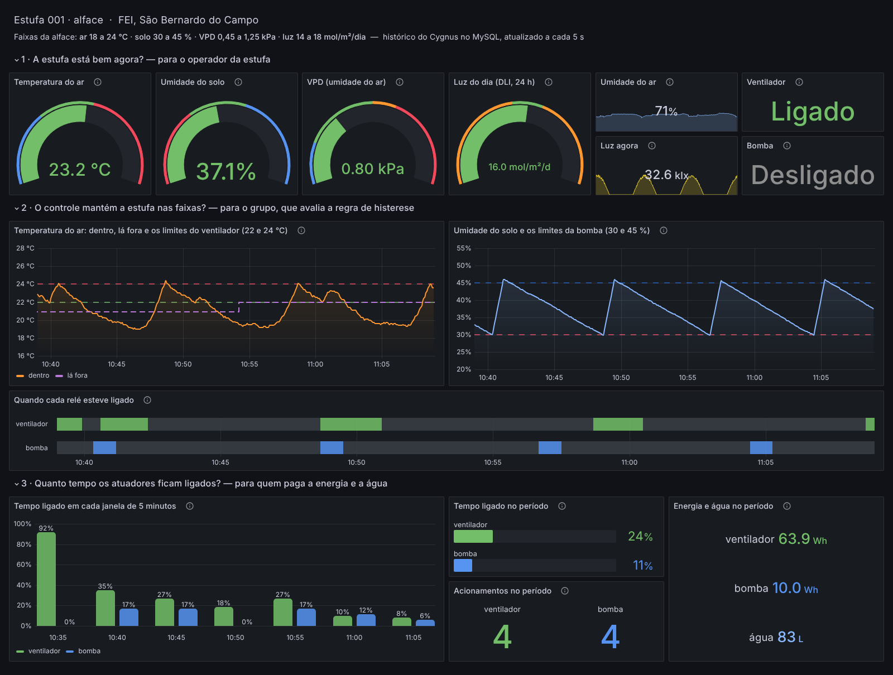

# Painel da estufa — marco da Aula 8 (25/11)

O marco pede três itens:
1. três perguntas que o painel responde, e para quem;
2. a visualização escolhida para cada uma;
3. a consulta SQL de cada painel.

**Critério de pronto:** o painel mostra dados **do próprio grupo**, gravados pelo Cygnus a partir de uma subscrição **que o grupo criou**.

**Cultura:** alface. As faixas do painel e os limites do controle são os da alface ([as decisões e de onde vem cada número](#as-decisões-da-cultura-e-de-onde-vem-cada-número)).

| Peça | Onde |
|---|---|
| Nó da estufa (ESP32 simulada) | `esp32_estufa/`, no tenant `estufa`: publica `t`, `h`, `v`, `m`, `l`, `f`, `p` e responde aos comandos |
| Clima externo | `gravador_clima/`: a cada 15 min, copia o `clima-externo` da Base para a `WeatherObserved:FEI` |
| Subscrições do grupo | criadas por `configurar.py`: **"Historico da estufa para o Cygnus"** e **"Clima externo para o Cygnus"** |
| Histórico | MySQL, banco `estufa`: tabelas `` `urn_ngsi-ld_Device_ESP32-001_Device` `` e `` `urn_ngsi-ld_WeatherObserved_FEI_WeatherObserved` `` |
| Painel | `grafana/paineis/painel_estufa.json`, servido em `http://localhost:3002` pelo serviço `grafana-estufa` |
| Serviços novos | `fiware/docker-compose.override.yml`; o `docker-compose.yml` da Base fica intacto |



## Como subir (Codespace ou máquina com Docker)

```bash
git pull
cd fiware
docker compose up -d --wait orion
docker compose up -d --wait iot-agent
docker compose up -d --wait cygnus            # inclui o MySQL
python3 ../estufa/configurar.py               # estufa, provisionamento e subscrições (pode repetir)
docker compose up -d --build esp32-estufa     # só DEPOIS do configurar.py
docker compose up -d --build gravador-clima   # sobe junto o clima-externo da Base
docker compose up -d grafana-estufa           # o painel, na porta 3002
```

**Para atualizar uma pilha que já roda a versão anterior** (LDR, limites 24/28 °C), pare a ESP32 antes. O `configurar.py` percebe que o `dispositivo.json` mudou e reprovisiona a placa, o que recria a entidade do nó. O histórico fica.

```bash
git pull
cd fiware
docker compose stop esp32-estufa
python3 ../estufa/configurar.py
docker compose up -d --build esp32-estufa
docker compose up -d --build gravador-clima
docker compose restart grafana-estufa
```

- **No Codespace:** aba **Portas** → porta **3002** → ícone do globo. O painel abre direto, sem login. Para editar, entre com `admin`/`admin`.
- **Espere alguns minutos:** as curvas começam vazias e o histórico cresce uma medida a cada 5 s. A física da simulação é acelerada:
  - um "dia" dura 10 min, com 5 min de sol e 5 de noite;
  - o ventilador cicla de dia e fica desligado à noite;
  - um ciclo da bomba leva cerca de 7 min.
- **O clima entra a cada 15 min.** Sem internet, o `clima-externo` responde valores simulados, com `source = simulado`.
- **Para conferir as subscrições:** `curl -s -H 'fiware-service: estufa' -H 'fiware-servicepath: /' localhost:1026/v2/subscriptions`. O esperado é `status: active`, `timesSent` subindo e `lastSuccessCode: 200`.
- **Para mandar um comando à mão:**

  ```bash
  curl -s -X PATCH 'localhost:1026/v2/entities/urn:ngsi-ld:Device:ESP32-001/attrs?type=Device' \
    -H 'fiware-service: estufa' -H 'fiware-servicepath: /' -H 'Content-Type: application/json' \
    -d '{"pumpOn": {"type": "command", "value": ""}}'
  ```

- **Para parar sem perder o histórico:** `docker compose stop`. Nunca use `down -v`.

## As três perguntas

| # | Pergunta | Para quem | Que decisão apoia | Visualização |
|---|---|---|---|---|
| 1 | **A estufa está bem agora?** | o operador da estufa | intervir já (ex.: 25 °C com o ventilador desligado, solo abaixo de 30 % sem a bomba, VPD acima de 1,5 kPa) | **Gauge** nas faixas da alface (temperatura, solo, VPD e DLI) + **Stat** com a curva do período (umidade do ar e luz) e o estado de cada relé |
| 2 | **O controle mantém a estufa nas faixas?** | o grupo, que projeta e ajusta a regra (e, na Aula 9, o gêmeo digital) | manter ou mudar os limites 22/24 °C e 30/45 %; ver se a histerese oscila rápido demais; separar "regra ruim" de "dia quente" com a temperatura de fora | **Time series** com as linhas dos limites e a temperatura externa + **State timeline** dos relés |
| 3 | **Quanto tempo os atuadores ficam ligados?** | quem paga a energia (ventilador) e a energia e a água (bomba) | prever o consumo; avaliar se mudar um limite compensa | **Bar chart** do tempo ligado por janela de 5 min + **Bar gauge** do período (%) + **Stat** (acionamentos, Wh e litros) |

Seguimos a regra da Aula 7: a pergunta escolhe a visualização.
- O valor de **agora** vai num Gauge, quando há uma faixa a respeitar, ou num Stat.
- A **evolução**, num Time series.
- O **estado** de cada relé, num State timeline.
- O **resumo por período**, num Bar chart.

As cores da Pergunta 1:

| Painel | Azul | Verde | Laranja | Vermelho |
|---|---|---|---|---|
| Temperatura | abaixo de 18 °C | 18 a 24 °C | — | a partir de 24 °C (o ventilador deve estar ligado) |
| Umidade do solo | a partir de 45 % (a bomba deve desligar) | 30 a 45 % | — | abaixo de 30 % (a bomba deve ligar) |
| VPD | abaixo de 0,45 kPa (ar úmido demais) | 0,45 a 1,25 kPa | 1,25 a 1,5 kPa | acima de 1,5 kPa (estresse) |
| DLI (24 h) | — | 14 a 18 mol/m²/dia | fora da faixa | — |

Umidade do ar e luz agora ficam sem faixa, só com a curva do período. Quem julga o ar é o VPD, e quem julga a luz é o DLI.

As cores das curvas são fixas em todo o painel: laranja para a temperatura, roxo para o clima de fora, azul-claro para a umidade e a água, amarelo para a luz, verde para o ventilador e azul para a bomba.

### A consulta de cada painel

Todas leem as tabelas do Cygnus. Nelas, `attrValue` é **texto** e `recvTimeTs` está em **milissegundos**, por isso as consultas usam `CAST` e `/ 1000`. As consultas ficam em `grafana/gerar_painel.py`, que gera o JSON do painel. Os limites, as potências e a vazão saem do `modelo-dados/`; se eles mudarem, rode o gerador de novo.

**Pergunta 1 — Gauge** (temperatura; o mesmo para `soilMoisture` e `vaporPressureDeficit`)

```sql
SELECT
  recvTimeTs / 1000 AS "time",
  CAST(attrValue AS DECIMAL(10,2)) AS "temperatura"
FROM `urn_ngsi-ld_Device_ESP32-001_Device`
WHERE attrName = 'temperature'
ORDER BY recvTimeTs DESC
LIMIT 1
```

**Pergunta 1 — Stat com curva** (umidade do ar e luz): a mesma consulta da Pergunta 2, com `relativeHumidity` ou `illuminance`; o Stat mostra o último valor e a curva ao fundo. A luz usa `CAST(attrValue AS DECIMAL(10,1)) / 1000`, para mostrar em klx.

**Pergunta 1 — Gauge do DLI** (formato *Table*; o painel tem janela própria de 24 h, independente do seletor)

```sql
SELECT
  AVG(CAST(attrValue AS DECIMAL(10,1))) * 0.0185 * 86400 / 1000000 AS "DLI"
FROM `urn_ngsi-ld_Device_ESP32-001_Device`
WHERE attrName = 'illuminance'
  AND $__unixEpochFilter(recvTimeTs / 1000)
```

**Pergunta 1 — Stat do relé** (formato *Table*, sem CAST; mapeamento `ON` → Ligado, `OFF` → Desligado)

```sql
SELECT attrValue AS "ventilador"
FROM `urn_ngsi-ld_Device_ESP32-001_Device`
WHERE attrName = 'fanState'
ORDER BY recvTimeTs DESC
LIMIT 1
```

**Pergunta 2 — Time series, dentro** (`temperature`; o mesmo para `soilMoisture`)

```sql
SELECT
  recvTimeTs / 1000 AS "time",
  CAST(attrValue AS DECIMAL(6,1)) AS "dentro"
FROM `urn_ngsi-ld_Device_ESP32-001_Device`
WHERE attrName = 'temperature'
  AND $__unixEpochFilter(recvTimeTs / 1000)
ORDER BY recvTimeTs ASC
```

**Pergunta 2 — Time series, lá fora** (consulta B do mesmo gráfico, em degraus)

Há uma leitura a cada 15 min, e uma janela de 30 min tem só duas ou três. A consulta junta três coisas: a última leitura antes da janela, as leituras da janela e a última leitura repetida no fim. Assim a linha cobre o gráfico inteiro, e cada leitura vale até a próxima.

```sql
SELECT t_s AS "time", externa AS "lá fora"
FROM (
  (SELECT recvTimeTs / 1000 AS t_s, CAST(attrValue AS DECIMAL(6,1)) AS externa
   FROM `urn_ngsi-ld_WeatherObserved_FEI_WeatherObserved`
   WHERE attrName = 'temperature' AND recvTimeTs < $__unixEpochFrom() * 1000
   ORDER BY recvTimeTs DESC LIMIT 1)
  UNION ALL
  (SELECT recvTimeTs / 1000, CAST(attrValue AS DECIMAL(6,1))
   FROM `urn_ngsi-ld_WeatherObserved_FEI_WeatherObserved`
   WHERE attrName = 'temperature' AND $__unixEpochFilter(recvTimeTs / 1000))
  UNION ALL
  (SELECT $__unixEpochTo(), CAST(attrValue AS DECIMAL(6,1))
   FROM `urn_ngsi-ld_WeatherObserved_FEI_WeatherObserved`
   WHERE attrName = 'temperature' AND recvTimeTs <= $__unixEpochTo() * 1000
   ORDER BY recvTimeTs DESC LIMIT 1)
) AS leituras
ORDER BY t_s
```

**Pergunta 2 — State timeline** (consulta A com `fanState`, consulta B com `pumpState`)

```sql
SELECT
  recvTimeTs / 1000 AS "time",
  attrValue AS "ventilador"
FROM `urn_ngsi-ld_Device_ESP32-001_Device`
WHERE attrName = 'fanState'
  AND $__unixEpochFilter(recvTimeTs / 1000)
ORDER BY recvTimeTs ASC
```

**Pergunta 3 — Bar chart** (tempo ligado por janela de 5 min)

```sql
SELECT
  $__unixEpochGroupAlias(recvTimeTs / 1000, '5m'),
  100 * AVG(CASE WHEN attrName = 'fanState'  THEN attrValue = 'ON' END) AS "ventilador",
  100 * AVG(CASE WHEN attrName = 'pumpState' THEN attrValue = 'ON' END) AS "bomba"
FROM `urn_ngsi-ld_Device_ESP32-001_Device`
WHERE attrName IN ('fanState', 'pumpState')
  AND $__unixEpochFilter(recvTimeTs / 1000)
GROUP BY 1
ORDER BY 1
```

**Pergunta 3 — Bar gauge do período** (formato *Table*): a mesma média, sem o `GROUP BY`.

**Pergunta 3 — Acionamentos** (formato *Table*: quantas vezes cada relé passou de OFF para ON)

```sql
SELECT
  SUM(attrName = 'fanState')  AS "ventilador",
  SUM(attrName = 'pumpState') AS "bomba"
FROM (
  SELECT attrName, attrValue,
         LAG(attrValue) OVER (PARTITION BY attrName ORDER BY recvTimeTs) AS anterior
  FROM `urn_ngsi-ld_Device_ESP32-001_Device`
  WHERE attrName IN ('fanState', 'pumpState')
    AND $__unixEpochFilter(recvTimeTs / 1000)
) AS mudancas
WHERE attrValue = 'ON' AND anterior = 'OFF'
```

**Pergunta 3 — Energia e água** (formato *Table*; os números são os nominais do `dispositivo.json`)

```sql
SELECT
  541  * 5 * SUM(attrName = 'fanState'  AND attrValue = 'ON') / 3600 AS "ventilador",
  180  * 5 * SUM(attrName = 'pumpState' AND attrValue = 'ON') / 3600 AS "bomba",
  1500 * 5 * SUM(attrName = 'pumpState' AND attrValue = 'ON') / 3600 AS "água"
FROM `urn_ngsi-ld_Device_ESP32-001_Device`
WHERE attrName IN ('fanState', 'pumpState')
  AND $__unixEpochFilter(recvTimeTs / 1000)
```

### As contas por trás dos painéis

**Tempo ligado.** A média das amostras dá a fração do tempo ligado:

$$
D = \frac{t_{ON}}{t_{total}} \approx \frac{1}{N} \sum_{i=1}^{N} s_i
$$

- **D:** ciclo de trabalho, a fração do tempo com o relé ligado (no painel, × 100 = %).
- **t_ON, t_total:** tempo ligado e tempo total do período, em segundos.
- **s_i:** vale 1 se a amostra *i* está `ON` e 0 se está `OFF`. Vem dos `fanState` e `pumpState` gravados pelo Cygnus.
- **N:** número de amostras no período, uma a cada 5 s (o intervalo da ESP32).

A aproximação vale porque as amostras são igualmente espaçadas: cada uma "representa" 5 s.

**Energia e água.** Como cada amostra `ON` vale Δt de relé ligado:

$$
E = \frac{P \cdot \Delta t \cdot \sum s_i}{3600} \qquad V = \frac{Q \cdot \Delta t \cdot \sum s_i}{3600}
$$

- **E:** energia no período (Wh).
- **V:** água no período (L).
- **P:** potência nominal (W). Vem de `fanRatedPower` = 541 W ou `pumpRatedPower` = 180 W, atributos estáticos da ESP32.
- **Q:** vazão nominal da bomba (L/h). Vem de `pumpFlowRate` = 1.500 L/h.
- **Δt = 5 s:** intervalo entre amostras.
- **Σ s_i:** número de amostras `ON` do relé no período.
- **3600:** converte segundos em horas.

Exemplo para 30 min (360 amostras), com o ventilador ligado em 72 e a bomba em 36:
- ventilador: E = 541 × 5 × 72 / 3600 = **54,1 Wh**;
- bomba: E = 180 × 5 × 36 / 3600 = **9,0 Wh**, e V = 1500 × 5 × 36 / 3600 = **75 L**.

A física da simulação é acelerada: o solo seca em minutos, e não em dias. Por isso esses números mostram o cálculo, e não o consumo de um dia real. Com a placa real, passam a ser o consumo de verdade.

**VPD.** Calculado na ESP32, com a temperatura e a umidade já arredondadas:

$$
VPD = e_s(T)\,(1-UR), \qquad e_s(T)=0{,}6108\,e^{\frac{17{,}27\,T}{T+237{,}3}}
$$

- **VPD:** déficit de pressão de vapor (kPa).
- **e_s(T):** pressão de vapor de saturação na temperatura T (kPa). É a equação de Tetens, a mesma da FAO-56.
- **T:** temperatura do ar (°C, DHT22).
- **UR:** umidade relativa de 0 a 1 (DHT22).

Exemplo: com T = 23,4 °C e UR = 0,72, e_s = 2,878 kPa e **VPD = 2,878 × 0,28 = 0,81 kPa** (verde).

**DLI.** A média de um dia inteiro vezes os segundos do dia dá a soma do dia:

$$
DLI = \frac{0{,}0185 \cdot \bar{E}_v \cdot 86\,400}{10^6}
$$

- **DLI:** luz diária integrada (mol/m²/dia).
- **Ē_v:** média da iluminância nas últimas 24 h (lx, BH1750).
- **0,0185:** converte lux em PPFD (µmol/m²/s), para luz do sol (tabela Apogee/Hydrofarm).
- **86 400:** segundos em um dia.
- **10⁶:** converte µmol em mol.

Exemplo: Ē_v = 10.000 lx dá DLI = 0,0185 × 10.000 × 86.400 / 10⁶ = **16,0 mol/m²/dia** (verde).

A conta é a definição do DLI quando as 24 h estão no histórico. Com menos tempo de dados, é uma projeção pelo que já foi medido. Na simulação, um "dia" dura 10 min, e a média de vários dias simulados é a mesma de um dia real com o mesmo perfil de luz.

## As decisões da cultura e de onde vem cada número

| O quê | Valor | De onde vem |
|---|---|---|
| Cultura | alface | decisão do grupo: ciclo curto e pede menos luz que o tomate |
| Faixa de temperatura da alface | 18 a 23 °C, com umidade relativa de 60 a 75 % | [Cultivando o Saber (FAG)](https://cultivandosaber.fag.edu.br/index.php/cultivando/article/download/632/554) |
| Ventilador | liga em 24 °C e desliga em 22 °C | premissa do grupo: logo acima do topo da faixa, com 2 °C de histerese |
| Faixa do VPD | 0,45 a 1,25 kPa; estresse acima de 1,5 kPa | [Groen Kennisnet](https://wiki-groenkennisnet.atlassian.net/wiki/x/XgC3) e [Vegetable Research (2023)](https://maxapress.com/data/article/vegres/preview/pdf/VR-2023-0020.pdf) |
| DLI da alface | 14 a 18 mol/m²/dia | [Michigan State University](https://www.canr.msu.edu/floriculture/uploads/files/investment-considerations.pdf) |
| Lux → PPFD (luz do sol) | 0,0185 µmol/m²/s por lx | [Apogee/Hydrofarm](https://s3.amazonaws.com/hydrofarmpubdocs/greenbeamsppfconversiontables.pdf) |
| BH1750 | 1 a 65.535 lx, ±20 % | [folha de dados AZ-Delivery](https://cdn.shopify.com/s/files/1/1509/1638/files/GY-302_Licht_Sensor_Modul_Datenblatt_AZ-Delivery_Vertriebs_GmbH.pdf) |
| Ventilação necessária | 1 renovação do ar por minuto; para 50 m² × 3 m de pé-direito (premissa), 150 m³/min | [Hortidaily](https://www.hortidaily.com/article/9857497/a-guide-to-greenhouse-ventilation-sizing/) |
| Ventilador: `fanRatedPower` | **541 W** = 6.604 cfm ÷ 12,2 cfm/W (J&D VNS30S850, 30", ½ HP). Entrega 187 m³/min, ou 1,25 renovação/min | [catálogo J&D](https://www.greenhousemegastore.com/j-d-typhoon-exhaust-fan-fa--vns) |
| Bomba: `pumpRatedPower` | **180 W** (Ferrari IDB-35, ¼ cv) | [catálogo do revendedor](https://www.lojadomecanico.com.br/produto/607325/33/619/bomba-periferica-idb-35-14cv-24-mca-110220v-ferrari-aab1010024) |
| Bomba: `pumpFlowRate` | **1.500 L/h**, a vazão máxima do catálogo. Na pressão do gotejamento, a vazão real é menor | o mesmo catálogo |
| Clima a cada 15 min | o "current" da Open-Meteo vem da previsão de 15 em 15 min | [Open-Meteo](https://open-meteo.com/) |

**Potência e vazão são nominais.** O próximo passo é medir, e então energia e água viram atributos de origem **medida**:
- a energia, com um sensor de energia (PZEM-004T na rede AC, ou INA219 em 12 V);
- a água, com um medidor de vazão.

**Escala:** os valores são da estufa de 50 m² do modelo. Para uma maquete, troque os três números em `modelo-dados/provisionamento/dispositivo.json`, rode o `configurar.py` e o `gerar_painel.py`.

## As três perguntas do marco da Aula 7

**1. Que tenant e que caminhos?**
- Tenant `estufa`, com `fiware-servicepath: /`, porque o projeto tem uma estufa só.
- Quando houver mais de uma, a ideia é usar um caminho por estufa (`/estufa001`, `/estufa002`), com um grupo de serviço por caminho. O painel e a aplicação passariam a ler com `/#`.
- Lembrete da Aula 7: sem o cabeçalho, a leitura vale para `/#` e a gravação para `/`.

**2. Que consultas a aplicação fará?** O modelo permite todas. Conferimos estas no Orion 4.1.0:

| Para quê | Consulta |
|---|---|
| alerta de calor | `GET /v2/entities?type=Device&q=temperature>24` |
| alerta de solo seco | `GET /v2/entities?type=Device&q=soilMoisture<30` |
| alerta de estresse hídrico | `GET /v2/entities?type=Device&q=vaporPressureDeficit>1.5` |
| os nós de uma estufa (pai → filhos) | `GET /v2/entities?q=controlledAsset==urn:ngsi-ld:AgriGreenhouse:001` |
| relés ligados | `GET /v2/entities?type=Device&q=fanState==ON` |
| só medidas em °C | `GET /v2/entities?type=Device&mq=temperature.unitCode==CEL` |
| estufas perto do campus | `GET /v2/entities?type=AgriGreenhouse&georel=near;maxDistance:1000&geometry=point&coords=-23.7245,-46.5793` |

**3. Que atributos vão para o histórico, e por qual subscrição?**

| Subscrição | Entidades | Atributos |
|---|---|---|
| **"Historico da estufa para o Cygnus"** | `idPattern ".*"`, type `Device` | `temperature`, `relativeHumidity`, `vaporPressureDeficit`, `soilMoisture`, `illuminance`, `fanState`, `pumpState` |
| **"Clima externo para o Cygnus"** | `urn:ngsi-ld:WeatherObserved:FEI` | `temperature`, `relativeHumidity`, `windSpeed`, `dateObserved`, `source` |

- As duas usam `attrsFormat: normalized`, `throttling: 1 s` e a URL `http://cygnus:5050/notify`.
- Ficam fora:
  - os comandos e o resultado deles (`fanOn`, `fanOn_status`…);
  - os atributos estáticos (potências, vazão, `controlledAsset`), que não mudam com o tempo;
  - a estufa, que também não muda.
- O `TimeInstant` vai junto, nos metadados (coluna `attrMd`).

Quanto isso grava:

$$
L = n_{attr} \times \frac{3600}{\Delta t}
$$

- **L:** linhas gravadas por hora.
- **n_attr:** os atributos da subscrição.
- **Δt:** o intervalo entre leituras.

| Fonte | n_attr | Δt | L |
|---|---|---|---|
| nó da estufa | 7 | 5 s | 7 × 720 = **5.040 linhas/h** |
| clima externo | 5 | 900 s | 5 × 4 = **20 linhas/h**, no máximo |

O nó grava cerca de 121 mil linhas por dia. É o custo do esquema "uma linha por atributo, tudo em texto", que é a questão de pesquisa da Aula 8. O clima grava no máximo 20 linhas por hora: se a leitura não mudou, o Orion não notifica (conferimos), e o histórico não ganha linha repetida.

## O clima externo: gravador, não registro

Na Base, o clima chega por **registro**: o Orion não guarda o valor e pergunta ao provedor a cada leitura. Registro não notifica, e sem notificação o Cygnus não grava (Aula 7).

Por isso, no tenant `estufa`, o `gravador-clima` faz a troca:
1. a cada 15 min, pede ao `clima-externo` o mesmo `op/query` que o Orion faria;
2. acrescenta as unidades (`CEL`, `C62`, `MTS`) e a posição;
3. grava a `WeatherObserved:FEI` no Orion com `op/update` (`append`);
4. a subscrição **"Clima externo para o Cygnus"** leva cada leitura nova ao MySQL.

**É um ou outro.** No tenant `estufa`, o clima não tem registro. Testamos os dois juntos no Orion 4.1.0: o Orion mistura as fontes. O atributo gravado sai do Orion, e o que faltar vem do provedor na hora, cada um com uma idade. O `configurar.py` recusa seguir se encontrar um registro do clima no tenant.

**Ressalva:** a Open-Meteo dá uma **estimativa de modelo** para a região, e não uma medida na estufa. Numa fase 2, um DHT22 do lado de fora (origem **medida**) resolve isso.

## Limitações e próximos passos

- **Dados simulados:** os dados vêm de uma ESP32 simulada, com física simplificada e acelerada para o painel mostrar vários dias e ciclos em 30 min. A placa real entra no lugar dela sem mudar a plataforma, porque usa o mesmo contrato MQTT. A simulação não usa o clima de fora.
- **Potência e vazão:** são nominais, de catálogo. Faltam o sensor de energia e o medidor de vazão.
- **Limites da bomba:** 30/45 % ainda não foram conferidos para a alface.
- **Regra de controle:** hoje é **local**, na ESP32 (histerese com os limites da AgriGreenhouse). Na Aula 9, o controlador e o gêmeo digital passam a ler esses limites do Orion.
- **Build local:** `docker compose up -d --build esp32-estufa` precisa de acesso ao PyPI (`pip install paho-mqtt`). No Codespace, funciona. O `gravador-clima` só usa a biblioteca padrão do Python.
