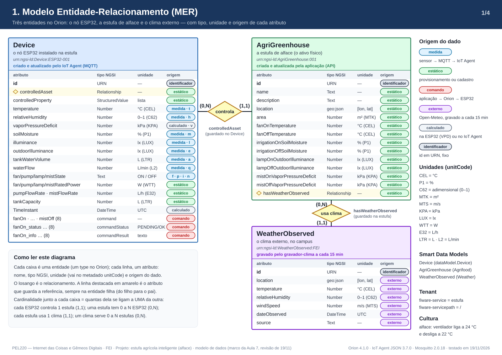

# Modelo de dados — Estufa agrícola inteligente (NGSI-v2)

Marco da Aula 7 (PEL220). Ele pede:
- o diagrama das entidades (3 tipos ou mais) e dos relacionamentos;
- para cada atributo, o tipo, a unidade e a origem;
- ids em URN;
- um JSON de exemplo por tipo, aceito pelo Orion e lido de volta;
- quem cria, atualiza e apaga cada entidade.

**Documento para apresentar:** [`Modelo de dados - Estufa PEL220.pdf`](Modelo%20de%20dados%20-%20Estufa%20PEL220.pdf), revisão de 19/11 (cultura: alface), com 4 páginas:
1. MER;
2. quem cria, atualiza e apaga cada entidade, e o checklist da Aula 6;
3. arquitetura e comunicação;
4. JSON de exemplo e resultado do teste.

A versão apresentada na Aula 7 (18/11) está no histórico do git, no commit `eece9b0`. O que mudou desde então está em [Mudanças depois da Aula 7](#mudanças-depois-da-aula-7).

- **Tenant:** `fiware-service: estufa` · `fiware-servicepath: /`
- **Chave do grupo no IoT Agent (apikey):** `estufa`
- **Unidades** (metadado `unitCode`, UN/CEFACT):
  - `CEL` = °C · `P1` = % · `C62` = adimensional (0–1);
  - `MTK` = m² · `MTS` = m/s;
  - `KPA` = kPa · `LUX` = lx · `WTT` = W · `E32` = L/h · `LTR` = L · `L2` = L/min.
- **Smart Data Models:** `Device` (dataModel.Device) · `AgriGreenhouse` (dataModel.Agrifood) · `WeatherObserved` (dataModel.Weather)
- **Cultura:** alface.



## Entidades

| Entidade | id | Papel | Quem escreve |
|---|---|---|---|
| `Device` | `urn:ngsi-ld:Device:ESP32-001` | o nó ESP32 da estufa | IoT Agent (MQTT) |
| `AgriGreenhouse` | `urn:ngsi-ld:AgriGreenhouse:001` | a estufa de alface (ativo físico) | aplicação (API) |
| `WeatherObserved` | `urn:ngsi-ld:WeatherObserved:FEI` | clima externo no campus | `gravador-clima`, a cada 15 min, com os dados do provedor de clima da Base |

**Relacionamentos.** Ficam sempre na entidade filha e apontam para o pai:
- `Device.controlledAsset` → `AgriGreenhouse`: cada nó controla 1 estufa; uma estufa tem de 0 a N nós.
- `AgriGreenhouse.hasWeatherObserved` → `WeatherObserved`: cada estufa usa 1 clima; um clima serve de 0 a N estufas.
- Para ir do pai aos filhos, use `GET /v2/entities?q=controlledAsset==urn:ngsi-ld:AgriGreenhouse:001`.

**Origem dos atributos** (categorias da Aula 6):
- **medida:** `t`, `h`, `m`, `l`, `e`, `a`, `q`, `f`, `p`, `i` e `n` via MQTT;
- **estático:** no provisionamento (`controlledAsset`, `controlledProperty`, as potências `…RatedPower`, as vazões `pumpFlowRate` e `mistFlowRate`, `tankCapacity`) ou no cadastro da estufa (limites de controle);
- **comando:** `fanOn`, `fanOff`, `pumpOn`, `pumpOff`, `lampOn`, `lampOff`, `mistOn`, `mistOff`, com os respectivos `_status` e `_info`;
- **externo:** o clima, da Open-Meteo, pelo provedor da Base;
- **calculado:** `v` (`vaporPressureDeficit`), na ESP32, a partir de `t` e `h`; e o `TimeInstant`, gerado pelo IoT Agent.

**Umidade relativa:** `relativeHumidity` vai de **0 a 1** (`C62`), como no SDM e no `clima-externo` da Base. O firmware divide a leitura do DHT22 por 100.

**Atributos do nó** (`Device`):

| Atributo | Sigla | Tipo | Unidade | Origem |
|---|---|---|---|---|
| `temperature` | `t` | Number | °C (`CEL`) | medida, DHT22 |
| `relativeHumidity` | `h` | Number | 0–1 (`C62`) | medida, DHT22 |
| `vaporPressureDeficit` | `v` | Number | kPa (`KPA`) | calculado na ESP32 (Tetens/FAO-56) |
| `soilMoisture` | `m` | Number | % (`P1`) | medida, sensor capacitivo |
| `illuminance` | `l` | Number | lx (`LUX`) | medida, BH1750 dentro, na altura das plantas (sol + lâmpadas; entra no DLI) |
| `outdoorIlluminance` | `e` | Number | lx (`LUX`) | medida, BH1750 no teto, lá fora (só o sol; decide as lâmpadas) |
| `tankWaterVolume` | `a` | Number | L (`LTR`) | medida, ultrassom na tampa da caixa (a ESP32 converte a distância em litros) |
| `waterFlow` | `q` | Number | L/min (`L2`) | medida, medidor de vazão de pulsos no cano depois da bomba |
| `fanState`, `pumpState`, `lampState`, `mistState` | `f`, `p`, `i`, `n` | Text | ON/OFF | medida, estado dos relés (ventilador, gotejamento, lâmpadas, nebulização) |
| `fanRatedPower` | — | Number | W (`WTT`) | estático: 541 W, nominal do ventilador |
| `pumpRatedPower` | — | Number | W (`WTT`) | estático: 180 W, nominal da bomba do gotejamento |
| `lampRatedPower` | — | Number | W (`WTT`) | estático: 2.000 W, das lâmpadas LED (premissa de projeto) |
| `mistRatedPower` | — | Number | W (`WTT`) | estático: 48 W, da bomba de diafragma da nebulização |
| `pumpFlowRate` | — | Number | L/h (`E32`) | estático: 1.500 L/h, vazão máxima de catálogo (a real é a `waterFlow`) |
| `mistFlowRate` | — | Number | L/h (`E32`) | estático: 60 L/h, 10 bicos de nebulização |
| `tankCapacity` | — | Number | L (`LTR`) | estático: 500 L, capacidade da caixa d'água |
| `controlledAsset` | — | Relationship | — | estático: a estufa |
| `controlledProperty` | — | StructuredValue | — | estático: o que o nó mede |

A origem dos valores nominais está em [`../estufa/README.md`](../estufa/README.md#as-decisões-da-cultura-e-de-onde-vem-cada-número).

**Tópicos MQTT:**

| Mensagem | Tópico | Exemplo |
|---|---|---|
| Medidas | `/json/estufa/estufa001/attrs` | `{"t": 23.4, "h": 0.72, "v": 0.81, "m": 38.5, "l": 21500, "e": 31600, "a": 486.5, "q": 0.0, "f": "OFF", "p": "OFF", "i": "OFF", "n": "OFF"}` |
| Comandos | `/estufa/estufa001/cmd` | `{"fanOn": ""}` (também `pumpOn`, `lampOn`, `mistOn` e os `…Off`) |
| Resultado | `/json/estufa/estufa001/cmdexe` | `{"fanOn": "OK - ventilador ligado"}` |

Os números vão sem aspas. Com `"23.4"` entre aspas, o valor vira texto e os filtros `q=temperature>24` deixam de funcionar.

## Mudanças depois da Aula 7

A cultura escolhida foi a **alface**.

| O que mudou | Antes (18/11) | Agora |
|---|---|---|
| Limites do ventilador (`fanOnTemperature` / `fanOffTemperature`) | 28 / 24 °C | **24 / 22 °C** |
| Sensor de luz | LDR, `lightLevel` em % (`P1`) | **BH1750**, `illuminance` em lx (`LUX`) |
| Umidade do ar | sem faixa | julgada pelo **VPD**: novo `vaporPressureDeficit` (kPa, calculado) |
| Energia | sem dados | **potências nominais**: `fanRatedPower`, `pumpRatedPower`, `lampRatedPower`, `mistRatedPower` (estáticos) |
| Luz | um BH1750 | **dois BH1750**: `illuminance` dentro (o DLI) e `outdoorIlluminance` no teto (decide as lâmpadas) |
| Lâmpadas LED | — | relé `lampState`, comandos `lampOn`/`lampOff`; limites `lampOnOutdoorIlluminance` = 15.000 lx e `lampOffOutdoorIlluminance` = 20.000 lx na estufa |
| Nebulização | — | relé `mistState`, comandos `mistOn`/`mistOff`, `mistFlowRate` = 60 L/h; limites `mistOnVaporPressureDeficit` = 1,25 kPa e `mistOffVaporPressureDeficit` = 0,95 kPa na estufa. A irrigação continua por gotejamento |
| Água | sem dados | **medida**: `tankWaterVolume` (L, ultrassom na caixa) e `waterFlow` (L/min, medidor de vazão); `tankCapacity` = 500 L (estático); `controlledProperty` ganha `waterLevel` e `waterFlow` (valores do SDM); `pumpFlowRate` fica como referência de catálogo |
| Clima externo | provedor, por **registro** (não vai ao histórico) | **gravador-clima** a cada 15 min + subscrição para o Cygnus; sem registro no tenant |
| Descrição da estufa | — | `description` = "Estufa de alface" |

As faixas, as fórmulas e a origem de cada número estão em [`../estufa/README.md`](../estufa/README.md).

## Arquivos

- `exemplos/AgriGreenhouse.json` e `exemplos/WeatherObserved.json`: o que a aplicação envia ao Orion (`POST /v2/op/update`). No projeto rodando, a `WeatherObserved` é gravada pelo `gravador-clima`, no mesmo formato.
- `provisionamento/grupo.json` e `provisionamento/dispositivo.json`: o grupo de serviço e a ESP32 no IoT Agent.
- `exemplos/*.lido.json`: o que o Orion devolveu no teste, no formato normalizado.

## Teste: aceito pelo Orion e lido de volta

```bash
cd fiware
docker compose up -d --wait iot-agent
python3 ../modelo-dados/testar_modelo.py
```

O teste roda num tenant só de teste (`estufa_teste`), com chave e `device_id` próprios. Assim, não mexe na ESP32 que está no ar nem põe valores de exemplo no histórico. Os JSON são os mesmos do projeto.

O script segue estes passos:
1. Cria o clima e a estufa no Orion.
2. Reprovisiona a ESP32 de teste no IoT Agent.
3. Publica uma medida MQTT.
4. Faz o ciclo completo de um comando: `PATCH fanOn` → `cmd` → `PENDING` → `cmdexe` → `fanOn_status = OK`.
5. Lê as três entidades no formato normalizado e confere:
   - id em URN com o tipo;
   - `value` coerente com o `type`;
   - `unitCode` em toda grandeza, igual ao do provisionamento;
   - `relativeHumidity` entre 0 e 1;
   - `tankWaterVolume` entre 0 e a `tankCapacity`;
   - `vaporPressureDeficit` coerente com a temperatura e a umidade;
   - potências, vazões nominais e capacidade da caixa iguais às do provisionamento;
   - os estados dos quatro relés e os 8 comandos registrados (ventilador, bomba, lâmpadas e nebulização);
   - os 8 limites de controle iguais aos da estufa;
   - existência do alvo de cada `Relationship`;
   - ausência de uma entidade `Thing:teste001`.

**Resultado em 19/11/2026** (Orion 4.1.0, IoT Agent JSON 3.7.0, Mosquitto 2.0.18): 132 verificações, 0 falhas.

## O modelo rodando

O nó da estufa publica neste modelo, e o histórico vai para o painel do grupo em [`../estufa/README.md`](../estufa/README.md), que é o marco da Aula 8.

## Em aberto para a Aula 7

- **Prefixo `ref`:** usamos os nomes do catálogo (`controlledAsset`, `hasWeatherObserved`), e não o prefixo `ref…`.
- **Medidas no `Device`:** no SDM, o `Device` não tem `temperature` nem `soilMoisture`. Seguimos o exemplo da Aula 1. O mesmo vale para `vaporPressureDeficit`, `illuminance`, `outdoorIlluminance`, `tankWaterVolume`, `waterFlow`, os estados dos relés e os valores nominais.
- **`hasAgriParcelParent`:** o SDM da `AgriGreenhouse` exige essa referência à parcela de terreno. `AgriParcel` é candidata a 4ª entidade.
- **Limites de controle:** ficam na estufa. O controlador da Base ainda lê `LIGA`/`DESLIGA` de variáveis de ambiente.
