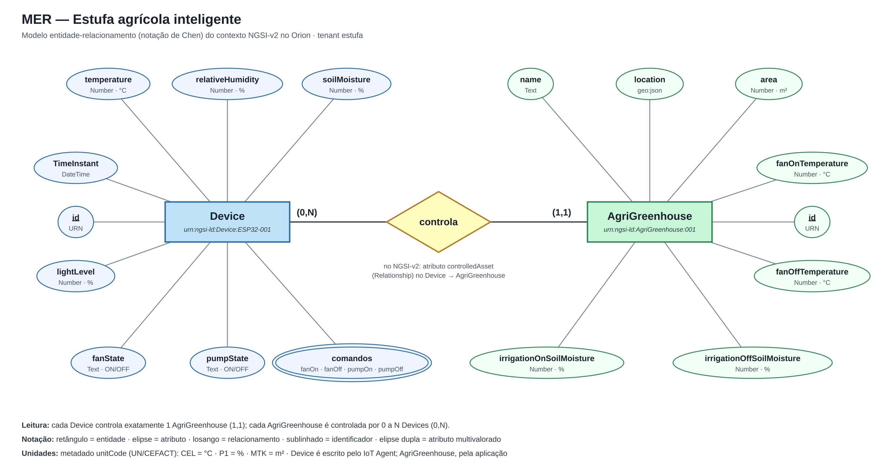
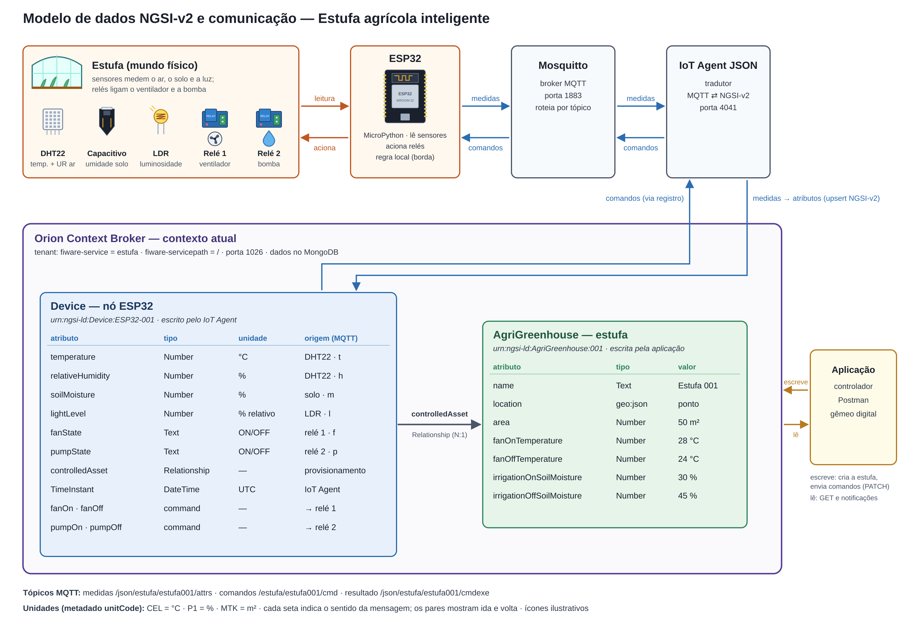
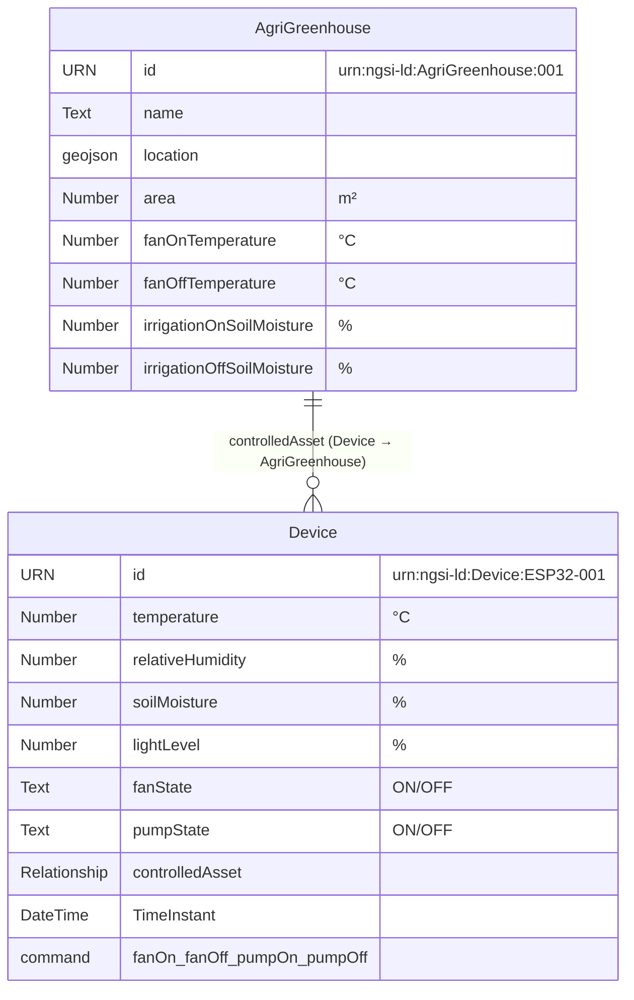

# Modelo de dados — Estufa agrícola inteligente (NGSI-v2)

Marco da Aula 7 (PEL220): entidades, atributos (tipo, unidade e origem), relacionamentos, ids em URN e um JSON de exemplo por tipo, **aceito pelo Orion e lido de volta**.

- **Tenant:** `fiware-service: estufa` · `fiware-servicepath: /`
- **Chave do grupo no IoT Agent (apikey):** `estufa`
- **Unidades:** metadado `unitCode` com códigos UN/CEFACT: `CEL` = °C · `P1` = % · `MTK` = m²

## MER (notação de Chen)



## Diagrama de arquitetura e comunicação



Versão em texto (Mermaid):



O relacionamento vai **do filho para o pai**: o nó aponta para a estufa que controla. Para listar os nós de uma estufa, use `GET /v2/entities?q=controlledAsset==urn:ngsi-ld:AgriGreenhouse:001`.

## Entidade `AgriGreenhouse`: a estufa (ativo físico)

Ela é criada pela **aplicação** (operador ou gêmeo digital) com `POST /v2/op/update`. Exemplo: [`exemplos/AgriGreenhouse.json`](exemplos/AgriGreenhouse.json).

| Atributo | `type` | Unidade | Exemplo | Origem / quem escreve |
|---|---|---|---|---|
| `name` | Text | — | `"Estufa 001"` | aplicação |
| `location` | geo:json (Point) | graus [lon, lat] | `[-46.5793, -23.7245]` | aplicação (premissa: coordenadas do campus usadas no `clima-externo`) |
| `area` | Number | m² (`MTK`) | `50` | aplicação (premissa) |
| `fanOnTemperature` | Number | °C (`CEL`) | `28` | aplicação: limite de histerese que liga o ventilador (igual a `LIGA` do controlador) |
| `fanOffTemperature` | Number | °C (`CEL`) | `24` | aplicação: desliga o ventilador (igual a `DESLIGA`) |
| `irrigationOnSoilMoisture` | Number | % (`P1`) | `30` | aplicação: liga a bomba abaixo deste valor (premissa) |
| `irrigationOffSoilMoisture` | Number | % (`P1`) | `45` | aplicação: desliga a bomba acima deste valor (premissa) |

Os limites ficam na estufa, e não no controlador, para que o gêmeo digital (Aula 9) possa lê-los e ajustá-los pelo Orion.

## Entidade `Device`: o nó ESP32

Quem escreve é o **IoT Agent**, a partir das mensagens MQTT. Provisionamento: [`provisionamento/dispositivo.json`](provisionamento/dispositivo.json). Lido de volta: [`exemplos/Device.lido.json`](exemplos/Device.lido.json).

| Atributo | `object_id` (MQTT) | `type` | Unidade | Origem |
|---|---|---|---|---|
| `temperature` | `t` | Number | °C (`CEL`) | DHT22, temperatura do ar |
| `relativeHumidity` | `h` | Number | % (`P1`) | DHT22, UR do ar |
| `soilMoisture` | `m` | Number | % (`P1`) | sensor capacitivo, após calibração no firmware |
| `lightLevel` | `l` | Number | % (`P1`) | LDR, nível **relativo** (0 a 100 % da escala do ADC), não lux |
| `fanState` | `f` | Text | `ON`/`OFF` | estado do relé do ventilador, informado pela ESP32 |
| `pumpState` | `p` | Text | `ON`/`OFF` | estado do relé da bomba, informado pela ESP32 |
| `controlledAsset` | — | Relationship | — | `static_attributes` do provisionamento, enviado com toda medida |
| `TimeInstant` | — | DateTime | ISO 8601 UTC | IoT Agent (`IOTA_TIMESTAMP=true`) |
| `fanOn`, `fanOff`, `pumpOn`, `pumpOff` | — | command | — | `commands` do provisionamento; geram `<cmd>_status` e `<cmd>_info` |

**Tópicos MQTT:**

| Mensagem | Tópico | Exemplo |
|---|---|---|
| Medidas | `/json/estufa/estufa001/attrs` | `{"t": 26.4, "h": 62.0, "m": 38.5, "l": 71.0, "f": "OFF", "p": "OFF"}` |
| Comandos | `/estufa/estufa001/cmd` | `{"fanOn": ""}` |
| Resultado | `/json/estufa/estufa001/cmdexe` | `{"fanOn": "OK - ventilador ligado"}` |

Os números vão **sem aspas**. Com `"26.4"` entre aspas, o valor vira texto e os filtros `q=temperature>25` deixam de funcionar.

## Teste: aceito pelo Orion e lido de volta

Com o Orion e o IoT Agent no ar, rode:

```bash
cd fiware
docker compose up -d --wait iot-agent
python3 ../modelo-dados/testar_modelo.py
```

O script cria a estufa, provisiona a ESP32, publica uma medida MQTT de exemplo e lê as duas entidades no formato normalizado. Ele confere:
- id em URN com o tipo;
- `value` coerente com o `type`, com as regras da seção 6.7 do material complementar;
- `unitCode` em toda grandeza numérica;
- existência do alvo de cada `Relationship`;
- ausência de uma entidade `Thing:estufa001`.

O que o Orion devolve fica salvo em `exemplos/*.lido.json`.

**Resultado em 16/11/2026** (Orion 4.1.0, IoT Agent JSON 3.7.0, Mosquitto 2.0.18): 41 verificações, 0 falhas.

## Pendências (Aula 7 em diante)

- Conferir os nomes contra os **Smart Data Models** (`AgriGreenhouse`, `Device`), em especial a convenção de `relativeHumidity`: % aqui, ou fração de 0 a 1.
- Decidir se os atuadores viram entidades próprias, por exemplo `Actuator:Fan001`, em vez de atributos do nó.
- Firmware da ESP32 da estufa: publicar `t`, `h`, `m`, `l`, `f` e `p` e responder aos quatro comandos.
